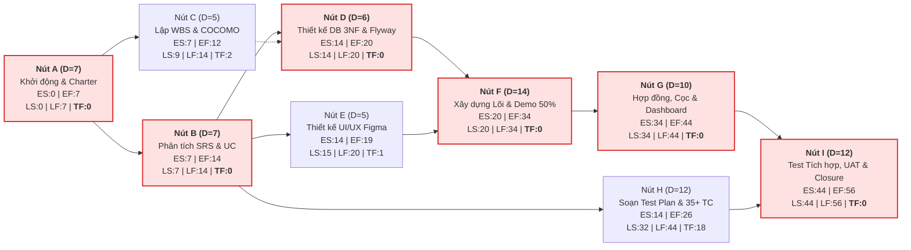

# Phân Tích Sơ Đồ Mạng PERT & Đường Găng Dự Án (Critical Path Method — CPM Analysis)

| Thông tin | Chi tiết |
| :--- | :--- |
| **Dự án** | LV34-001 — EVManager: Hệ thống Quản lý Trung tâm Hội nghị & Tiệc cưới |
| **Học phần** | MAN104 — Quản lý Dự án CNTT |
| **Mã công việc** | PM-09 & PM-10 (Issues #15, #16 — Xây dựng sơ đồ mạng PERT và xác định đường găng CPM) |
| **Người thực hiện** | Phạm Lê Huy Hoàng (Project Manager) |
| **Ngày lập** | 19/09/2026 (Tuần 2) |
| **Bảng tính liên kết** | [`docs/submission/QLDA_Nhom_LichDuAn.xlsx`](../submission/QLDA_Nhom_LichDuAn.xlsx) (Sheet `PERT & CPM`) |

---

## 1. Phương pháp Ước lượng Thời gian 3 Điểm (Three-Point PERT Estimation)

Để giảm thiểu sai số ước lượng tiến độ trong 8 tuần (40 ngày làm việc hành chính, hoặc 56 ngày lịch), Ban Quản lý dự án áp dụng công thức ước lượng PERT 3 điểm cho 9 cụm công việc nút mạng trọng tâm ($A \rightarrow I$):
$$t_e = \frac{t_o + 4t_m + t_p}{6}, \quad \sigma = \frac{t_p - t_o}{6}$$
Trong đó:
- $t_o$ (*Optimistic*): Thời gian lạc quan nhất.
- $t_m$ (*Most Likely*): Thời gian khả dĩ nhất.
- $t_p$ (*Pessimistic*): Thời gian bi quan nhất.
- $t_e$ (*Expected Duration*): Thời gian kỳ vọng dùng để tính đường găng CPM.

---

## 2. Bảng Tính Forward Pass, Backward Pass & Thời gian Dự trữ (Total Float)

Quy ước tính theo **Ngày lịch dự án (Tổng quỹ thời gian: 56 ngày = 8 tuần)**:

| Mã nút | Tên cụm công việc (Activity Node) | Công việc trước (Predecessor) | Thời lượng kỳ vọng $D$ (Ngày) | Bắt đầu sớm ($ES$) | Kết thúc sớm ($EF = ES + D$) | Bắt đầu muộn ($LS = LF - D$) | Kết thúc muộn ($LF$) | Dự trữ toàn phần ($TF = LS - ES$) | Thuộc Đường găng? |
| :---: | :--- | :---: | :---: | :---: | :---: | :---: | :---: | :---: | :---: |
| **A** | Khởi động dự án, lập Project Charter, Scope & RACI | — | **7** | 0 | 7 | 0 | 7 | **0** | 🔴 **CÓ (Găng)** |
| **B** | Phân tích nghiệp vụ, vẽ BPMN, lập SRS v1.0 & Use Cases | A | **7** | 7 | 14 | 7 | 14 | **0** | 🔴 **CÓ (Găng)** |
| **C** | Lập WBS, sơ đồ PERT/CPM, Gantt Baseline & COCOMO | A | **5** | 7 | 12 | 9 | 14 | **2** | 🟢 Không ($TF = 2$) |
| **D** | Thiết kế ERD 3NF (13 bảng), Data Dictionary & Flyway Schema | B | **6** | 14 | 20 | 14 | 20 | **0** | 🔴 **CÓ (Găng)** |
| **E** | Thiết kế UI/UX Wireframe, Prototype Figma & Layout khung | B | **5** | 14 | 19 | 15 | 20 | **1** | 🟢 Không ($TF = 1$) |
| **F** | Phát triển Backend Lõi (Auth JWT, RBAC, Venues, Conflict Checker) & Demo 50% | D, E | **14** | 20 | 34 | 20 | 34 | **0** | 🔴 **CÓ (Găng)** |
| **G** | Phát triển Phân hệ Hợp đồng Wizard 3 bước, Thực đơn, Dịch vụ, Đặt cọc & Dashboard | F | **10** | 34 | 44 | 34 | 44 | **0** | 🔴 **CÓ (Găng)** |
| **H** | Thiết kế Test Plan, 35+ Test Cases & Kịch bản kiểm thử độc lập | B | **12** | 14 | 26 | 32 | 44 | **18** | 🟢 Không ($TF = 18$) |
| **I** | Kiểm thử Tích hợp/Hồi quy/Hiệu năng, Nghiệm thu UAT & Đóng dự án | G, H | **12** | 44 | 56 | 44 | 56 | **0** | 🔴 **CÓ (Găng)** |

---

## 3. Sơ Đồ Mạng Công Việc PERT/CPM (Network Diagram)

---

## 4. Kết luận Đường găng (Critical Path) & Chiến lược Tối ưu Tiến độ

1. **Chuỗi công việc Đường găng (Critical Path):**
   $$\mathbf{A \rightarrow B \rightarrow D \rightarrow F \rightarrow G \rightarrow I}$$
   - **Tổng độ dài đường găng:** $7 + 7 + 6 + 14 + 10 + 12 = \mathbf{56 \text{ ngày lịch (Đúng 8 tuần)}}$.
   - Mọi sự chậm trễ trên 6 nút mạng $A, B, D, F, G, I$ ($TF = 0$) đều làm trễ ngày bảo vệ đồ án nếu không có biện pháp can thiệp.
2. **Chiến lược Rút ngắn Đường găng đã áp dụng:**
   - **Fast-tracking giữa nút $F$ và $G$:** Cho phép Frontend phát triển giao diện Đặt tiệc & Hợp đồng song song với lúc Backend viết API dựa trên hợp đồng DTO đã chốt (chi tiết tại [`docs/planning/fast-tracking-plan.md`](fast-tracking-plan.md)).
   - **Điều chuyển nhân lực từ nhánh có dự trữ lớn ($H$ có $TF = 18$ ngày):** Sau khi Hậu (QA) hoàn tất thiết kế 35+ Test Cases ở ngày thứ 26, Hậu được điều động sang hỗ trợ viết Flyway Seed Data và kiểm thử tích hợp sớm cho nút $F$ và $G$, giúp triệt tiêu độ trễ 1.5 ngày ở giai đoạn giữa kỳ.
