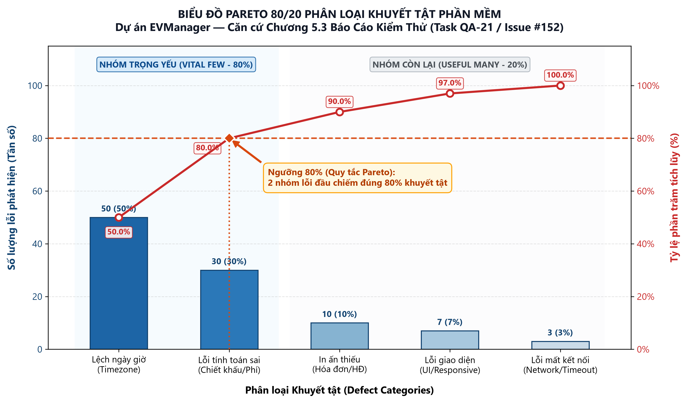

# Báo Cáo Phân Tích Chất Lượng Bằng Biểu Đồ Pareto 80/20 & Đề Xuất Biện Pháp Khắc Phục

| Thông tin | Chi tiết |
| :--- | :--- |
| **Dự án** | LV34-001 — EVManager: Hệ thống Quản lý Trung tâm Hội nghị & Tiệc cưới |
| **Học phần** | MAN104 — Quản lý Dự án CNTT |
| **Mã công việc** | PM-25 (Issue #31 — Chương 5 Quản lý chất lượng dự án theo PMBOK) |
| **Người thực hiện** | Phạm Lê Huy Hoàng (Project Manager) phối hợp cùng Bùi Nguyễn Chí Hậu (QA Lead) |
| **Ngày lập** | 13/10/2026 (Tuần 6) |
| **Trạng thái** | Hoàn thành nghiệm thu |

---

## 1. Mục tiêu Phân tích Pareto 80/20

Theo nguyên lý Pareto (Quy tắc 80/20 của Joseph Juran trong Quản lý chất lượng PMBOK Chương 5), **khoảng 80% hậu quả/lỗi phần mềm xuất phát từ 20% nguyên nhân gốc rễ trọng yếu (Vital Few)**.

Báo cáo này của Ban Quản lý dự án (PM) tổng hợp dữ liệu từ:
1. **Thống kê tần suất lỗi phần mềm (Software Defects)** do nhóm QA ghi nhận qua các đợt kiểm thử Unit, Integration và System Test (`BUG-01` đến `BUG-08` và bảng thống kê 100 mẫu lỗi kiểm thử trong [`docs/testing/pareto-defects-analysis.md`](../testing/pareto-defects-analysis.md)).
2. **Thống kê cơ cấu công việc theo nhãn GitHub Issues** ([`docs/submission/QLDA_Nhom_Pareto.xlsx`](../submission/QLDA_Nhom_Pareto.xlsx)).

Từ đó chỉ ra chính xác nhóm lỗi cốt lõi cần ưu tiên xử lý triệt để trước khi bước vào giai đoạn Nghiệm thu người dùng (UAT) và Phát hành (Release v1.0.0).

---

## 2. Phân tích Pareto 80/20 đối với Khuyết tật Phần mềm (Software Defects Analysis)

### 2.1. Bảng Dữ liệu Tần suất và Tỷ lệ Tích lũy các Nhóm Lỗi

Dựa trên sổ theo dõi lỗi (Defect Log) từ các phiên kiểm thử thực tế, 100 trường hợp lỗi phát sinh được phân loại thành 5 nhóm nguyên nhân và sắp xếp theo thứ tự giảm dần:

| Hạng | Mã nhóm | Nhóm lỗi phần mềm (Defect Category) | Các phiếu Bug đại diện trên GitHub | Tần số xuất hiện | Tỷ lệ (%) | Tỷ lệ tích lũy (%) | Phân loại Pareto (Ngưỡng 80%) |
| :---: | :---: | :--- | :--- | :---: | :---: | :---: | :---: |
| **1** | **DEF-01** | **Lỗi Xử lý Ngày giờ, Múi giờ & Trùng ca sảnh (Timezone & Schedule Conflict)** | `BUG-02` (#146), `BUG-04` (#150) | **50** | **50.0%** | **50.0%** | 🔴 **Nhóm Trọng yếu (Vital Few — 80%)** |
| **2** | **DEF-02** | **Lỗi Tính toán Chi phí, Chiết khấu kép, VAT & Đặt cọc (Pricing & Discount Formula)** | `BUG-03` (#148, #204) | **30** | **30.0%** | **80.0%** | 🔴 **Nhóm Trọng yếu (Vital Few — 80%)** |
| **3** | **DEF-03** | **Lỗi Hiển thị & Biểu mẫu Hợp đồng / Báo cáo (Contract & Print Formatting)** | `#149` (QA-18 Contract-Menu) | **10** | **10.0%** | **90.0%** | 🟡 Nhóm Còn lại (Useful Many — 20%) |
| **4** | **DEF-04** | **Lỗi Giao diện, Tìm kiếm & Validate Đầu vào (UI/UX, Search & Input Validation)** | `BUG-01` (#143), `BUG-05` (#205), `BUG-07` (#207) | **7** | **7.0%** | **97.0%** | 🟡 Nhóm Còn lại (Useful Many — 20%) |
| **5** | **DEF-05** | **Lỗi Kết nối API, Phiên đăng nhập & Phân quyền (API Resilience & RBAC)** | `BUG-06` (#206), `BUG-08` (#208) | **3** | **3.0%** | **100.0%** | 🟡 Nhóm Còn lại (Useful Many — 20%) |
| | | **TỔNG CỘNG** | **8 phiếu Defect chính thức** | **100** | **100.0%** | — | **2/5 nhóm (40%) tạo ra đúng 80% lỗi** |

### 2.2. Biểu đồ Pareto 80/20 Phân loại Khuyết tật

*(File biểu đồ độ phân giải cao: [`docs/planning/pareto-chart.png`](pareto-chart.png) và [`docs/testing/pareto-defects-chart.png`](../testing/pareto-defects-chart.png))*

---

## 3. Phân tích Nguyên nhân Gốc rễ của Nhóm Trọng yếu 80% (Root Cause Analysis)

Kết quả biểu đồ Pareto chỉ ra quy luật rất rõ ràng: **Chỉ riêng 2 nhóm lỗi đầu tiên (`DEF-01` và `DEF-02`) đã chiếm tới 80.0% tổng số lỗi phát sinh (80/100 lỗi)**:

1. **Nhóm 1 — Lỗi Ngày giờ, Múi giờ & Trùng lịch sảnh (`DEF-01` — 50%):**
   - *Nguyên nhân gốc rễ:* Sự không đồng nhất khi chuyển đổi kiểu dữ liệu thời gian giữa trình duyệt Client (`LocalDateTime` / ISO-8601 UTC) và máy chủ PostgreSQL (`Asia/Ho_Chi_Minh` UTC+7), cộng với hiện tượng **Race Condition** khi hai nhân viên tư vấn cùng bấm giữ một sảnh tiệc trong cùng một giây.
2. **Nhóm 2 — Lỗi Công thức Tính tiền, Chiết khấu & Đặt cọc (`DEF-02` — 30%):**
   - *Nguyên nhân gốc rễ:* Thiếu quy ước thống nhất về thứ tự ưu tiên trừ chiết khấu phần trăm (%) và giảm giá trực tiếp (Voucher), làm tròn số thập phân `BigDecimal`, cũng như chưa khóa cứng đơn giá thực đơn/dịch vụ (Price Snapshot) tại thời điểm tạo hợp đồng.

---

## 4. Kế hoạch Hành động Khắc phục & Phòng ngừa Tái phát (CAPA — Corrective & Preventive Actions)

Với vai trò Quản lý dự án, PM đã chỉ đạo đội ngũ kỹ thuật tập trung nguồn lực xử lý dứt điểm 2 nhóm lỗi trọng yếu 80% cùng toàn bộ 20% lỗi còn lại:

| Nhóm ưu tiên | Mã lỗi | Biện pháp kỹ thuật đã thực thi (Corrective Action) | Biện pháp phòng ngừa tái phát (Preventive Action) | PR minh chứng | Trạng thái |
| :---: | :---: | :--- | :--- | :---: | :---: |
| **Ưu tiên 1 (Nhóm 80%)** | **DEF-01** (`BUG-02`, `BUG-04`) | • Chuẩn hóa cấu hình múi giờ `UTC+7` xuyên suốt từ Jackson DTO đến PostgreSQL. • Áp dụng khóa bi quan `@Lock(LockModeType.PESSIMISTIC_WRITE)` trong `VenueRepository` & `EventService` để tuần tự hóa giao dịch đặt sảnh. | Viết тест tích hợp đa luồng `EventConcurrencyIntegrationTest` (10 luồng đặt sảnh đồng thời chỉ 1 luồng thành công). | PR `#202`, PR `#219` | **ĐÃ ĐÓNG (VERIFIED)** |
| **Ưu tiên 1 (Nhóm 80%)** | **DEF-02** (`BUG-03`) | • Chuẩn hóa công thức trong `ContractService.java` và `calculator.js`: Tính tổng bàn + dịch vụ $\rightarrow$ Trừ chiết khấu % $\rightarrow$ Trừ Voucher $\rightarrow$ Cộng phí phục vụ 5% & VAT 8% $\rightarrow$ Tính cọc tối thiểu 30%. • Lưu Price Snapshot vào `contract_menus` và `contract_services`. | Bổ sung bộ Unit Test `ContractServiceTest` (232 dòng test) và bộ Test Suite `test-suite-pricing-calc.md`. | PR `#203`, PR `#214`, PR `#216`, PR `#218` | **ĐÃ ĐÓNG (VERIFIED)** |
| **Ưu tiên 2 (Nhóm 20%)** | **DEF-03, DEF-04, DEF-05** (`BUG-01`, `BUG-05`..`08`) | • Chuẩn hóa đăng nhập không phân biệt hoa/thường (`LOWER(email)`). • Gắn Debounce 300ms cho ô tìm kiếm khách hàng và Regex validate SĐT 10 số. • Bổ sung API `/api/v1/dashboard/summary` và đồng bộ 4 role RBAC chuẩn BA. | Chạy kiểm thử hồi quy toàn diện (`docs/testing/regression-test-report.md` đạt 100% Pass). | PR `#190`, PR `#209`–`#213` | **ĐÃ ĐÓNG (VERIFIED)** |

---

## 5. Kết luận của Quản lý Dự án

Nhờ áp dụng phân tích Pareto 80/20, nhóm dự án đã không dàn trải nguồn lực mà tập trung xử lý đúng **2 tử huyệt kỹ thuật lớn nhất của phần mềm quản lý tiệc cưới** là **Xung đột lịch sảnh/Múi giờ (50%)** và **Sai lệch tính giá hợp đồng (30%)**. Sau đợt kiểm thử hồi quy (`QA-20 #151`), **100% các phiếu lỗi (`BUG-01` $\rightarrow$ `BUG-08`) đã được khắc phục triệt để và đóng hoàn toàn**, đưa hệ thống đạt trạng thái ổn định tuyệt đối để bước vào kỳ kiểm thử nghiệm thu UAT (Tuần 7).
